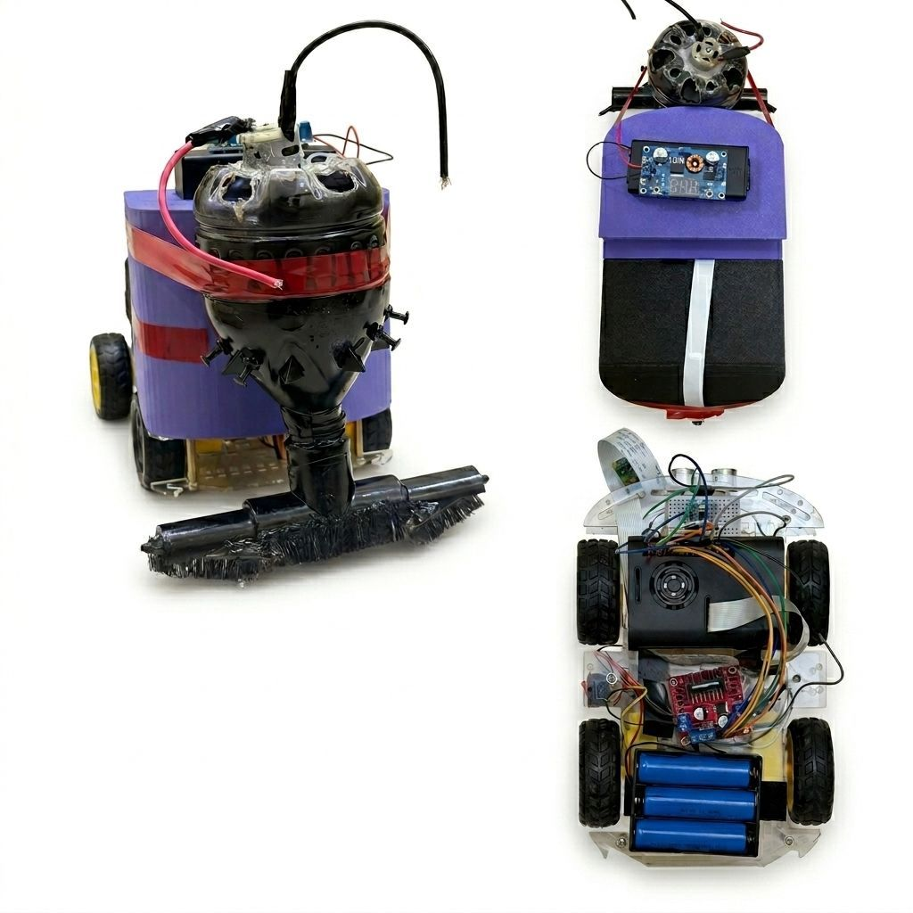
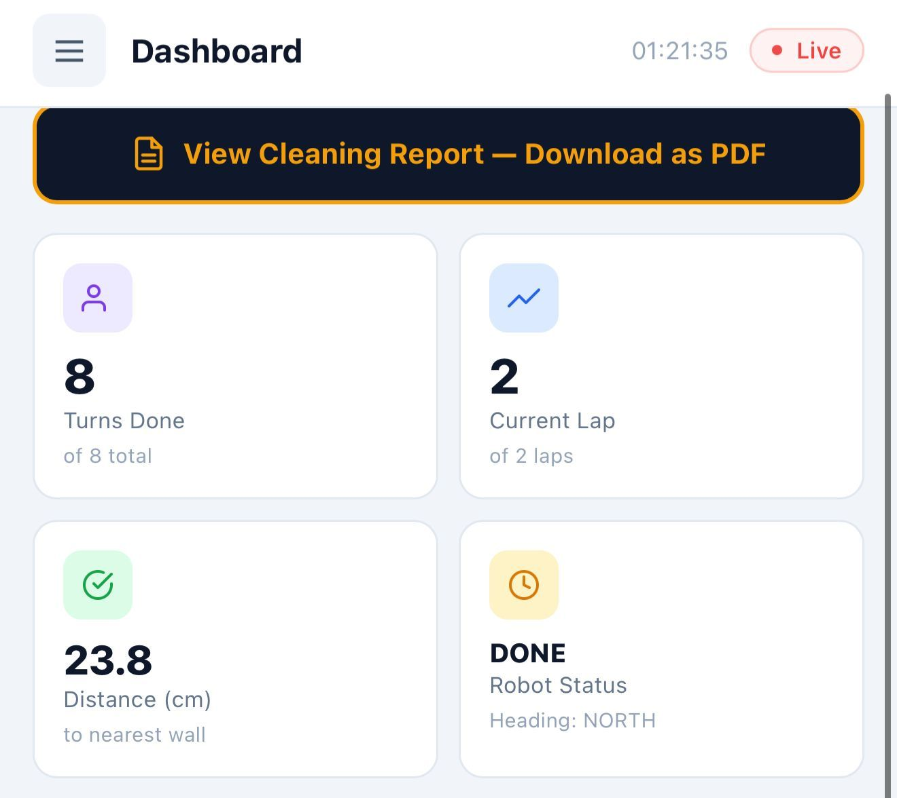
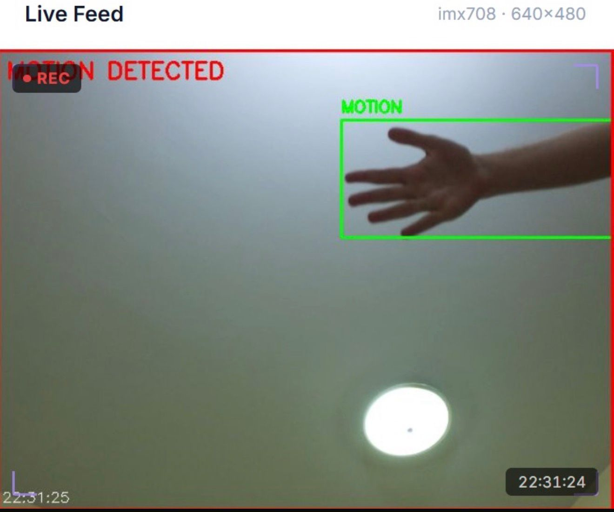
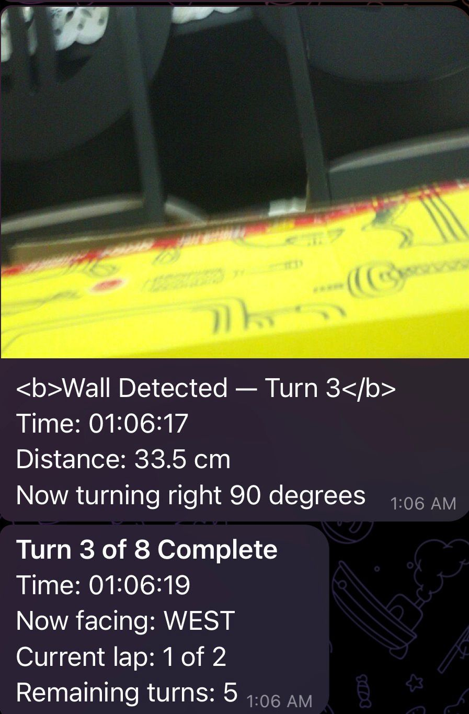
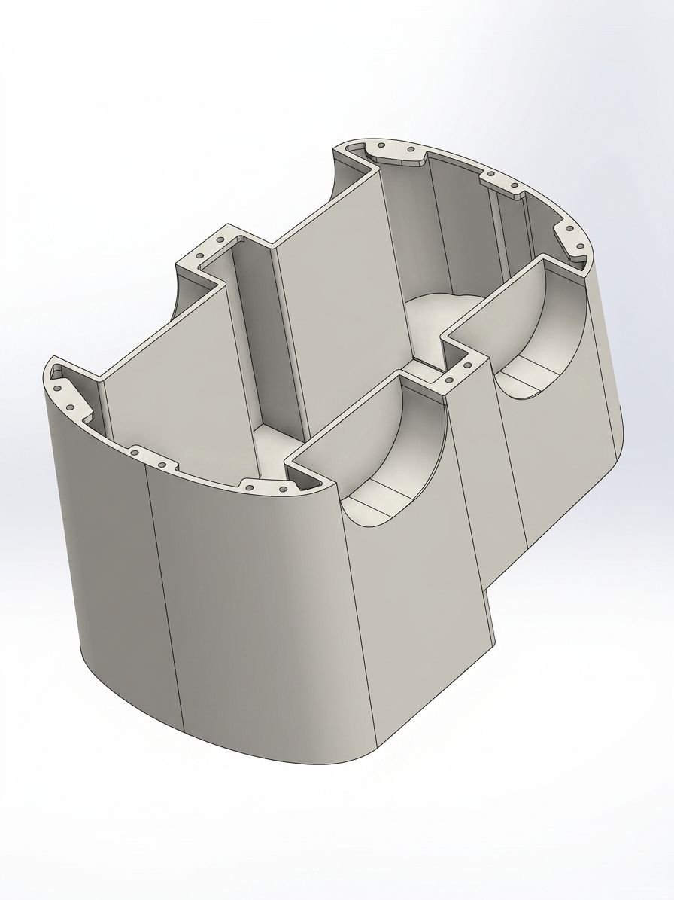
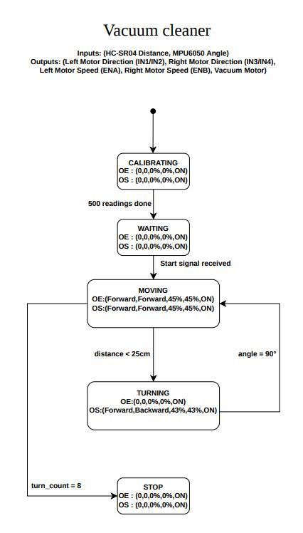

<h1 align="center">Smart Vacuum Robot</h1>

<p align="center">
  <b>Competition Winner</b> · CEN425 Internet of Things · Abu Dhabi University
</p>

<p align="center">
  
  
  
  
  
</p>

<p align="center">
  <a href="https://www.youtube.com/watch?v=FAOpOLqUXrA"><b>Watch the demo video</b></a>
</p>

<p align="center">
  
</p>

An autonomous vacuum robot that drives the perimeter of a 2 m × 1 m arena twice, uses an ultrasonic sensor to find walls and a gyroscope to make precise 90° turns, and streams everything live to a web dashboard and a Telegram bot. It also works as a security camera, with OpenCV motion detection and automatic photo alerts.

## Highlights

- **Autonomous navigation:** 2 laps and 8 right turns, controlled by a finite state machine
- **Gyro-guided turns:** the MPU6050 is read directly over I²C. A stop zone of 84.8–88° instead of a single target angle eliminates overshoot.
- **Wall detection:** an HC-SR04 ultrasonic sensor stops the robot 25 cm from a wall
- **Live web dashboard:** five pages (Dashboard, Live Camera, Sensor Data, Mission Log, Settings) served from the Pi, mobile responsive, with Start and Stop controls
- **Computer vision:** OpenCV MOG2 background subtraction with bounding boxes and a red alert overlay
- **Telegram bot:** turn and mission alerts, wall-detection photos, and a security snapshot every 5 seconds
- **Cleaning report:** a daily summary of sessions, laps, turns, photos and motion events that you can download as a PDF
- **Custom 3D-printed chassis:** designed in Autodesk Inventor, printed in PLA, with carbon-fibre-reinforced brackets

## Gallery

| Web dashboard | Motion detection |
|:--:|:--:|
|  |  |
| **Telegram alerts** | **3D chassis (Autodesk Inventor)** |
|  |  |

## How it works

<p align="center"></p>

| State | What happens |
|---|---|
| `CALIBRATING` | Collects 500 gyroscope samples to cancel drift |
| `WAITING` | Waits for Start from the dashboard |
| `MOVING` | Drives forward with a PWM soft start while reading the distance |
| `TURNING` | Turns right until the integrated gyro angle reaches the stop zone |
| `STOP` | Stops after 8 turns (2 full laps) and sends the mission report |

## Hardware

| Component | Role |
|---|---|
| Raspberry Pi 4 | Main controller, web server, vision |
| Pi Camera Module 3 (imx708) | Live MJPEG stream and photos |
| MPU6050 | Gyroscope for 90° turns |
| HC-SR04 | Ultrasonic wall detection |
| L298N motor driver + 4 DC motors | Drive train (hardware PWM via `lgpio`) |
| Vacuum motor + brush | Cleaning |
| 3× Li-ion cells + buck converter | Power |

## Engineering challenges solved

- **Broken PWM on Bookworm:** `RPi.GPIO` produced unstable PWM, so the robot switched to hardware PWM through `lgpio`.
- **Turn overshoot:** a single target angle overshot, so a threshold zone now stops the robot accurately.
- **MPU6050 libraries failing:** I bypassed them and talked to the sensor directly over `smbus2`.
- **Laggy dashboard buttons:** a single-threaded server blocked on the camera stream, so it now uses a `ThreadingMixIn` server.
- **Corrupted camera frames:** concurrent access from the vision and capture threads was fixed with a camera lock.

## Running it

```bash
pip install lgpio smbus2 opencv-python numpy requests picamera2
export TELEGRAM_TOKEN="your-bot-token"
export TELEGRAM_CHAT_ID="your-chat-id"
python3 src/robot_final.py
```

Then open `http://<pi-ip>:8888` from any device on the same network.

## Documents

- [Technical report](docs/Smart_Vacuum_Robot_Report.pdf)
- [Finite state machine](docs/Finite_State_Machine.pdf)
- [Schematic diagram](docs/Schematic_Diagram.pdf)
- [3D chassis model](docs/3D_Chassis_Model.pdf)

---

<p align="center">Built by <a href="https://github.com/loliamro">Amr Jalad</a> · <a href="https://www.linkedin.com/in/amrjallad/">LinkedIn</a></p>
